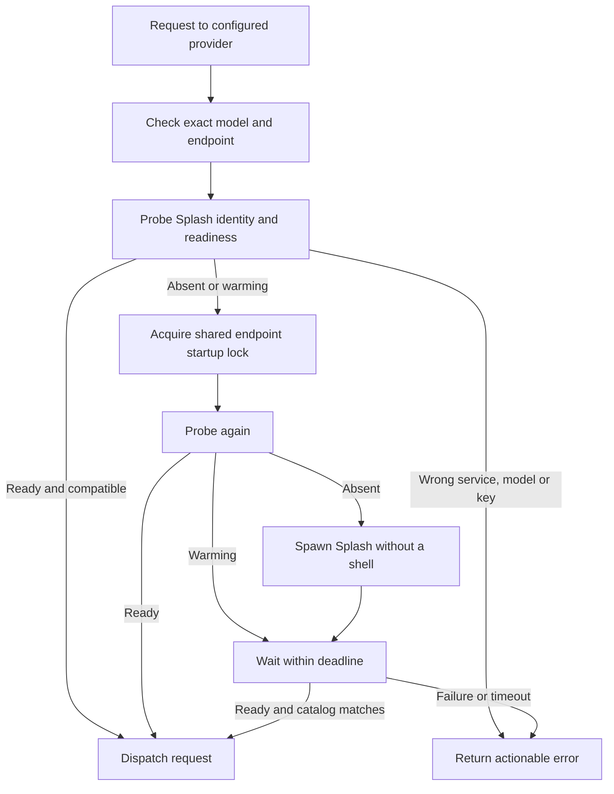

# Architecture and lifecycle

## Contract

One plugin entry owns the readiness policy for one provider, one exact Splash model selection and one `127.0.0.1` port. It starts nothing during setup, catalog refresh or model selection. The first actual model request is the activation boundary.

Use `ctx.session.hook("model.request", async callback, { providerID })`, rather than a prompt-admission hook. Provider resolution has happened at this point, and the hook covers `primary`, `title`, `compaction` and `generate` requests without changing prompt history. Hook rejection stops dispatch. [OpenCode V2 hooks](https://opencode.ai/v2/docs/build/plugins#model-request)

Provider registration contributes immutable source metadata through `ctx.provider.transform`. It uses the native `@opencode/ai/providers/openai-compatible` transport. Request-specific base URL/auth changes stay in the hook; no global config rewrite or transport monkey patch is needed.

## Coordination

In-process singleflight prevents duplicate work when sessions request the provider concurrently. Across processes, `proper-lockfile` uses an atomic directory lock named by host/port, with a two-second heartbeat and a fixed fifteen-second stale threshold. The lock lasts through readiness, not through inference. Every instance must use the same state directory and lock timing. Keep it on a local filesystem.

After acquiring the lock, probe again before spawning. Waiters keep probing and can return as soon as the server is ready. A crashed OpenCode process can leave a detached startup alive; after stale-lock recovery the next process reuses it instead of spawning another engine. Splash 1.3.0 also holds its own OS lock per port across its launcher `exec`; that is the final guard against separate installations/configurations racing. [Splash launcher](https://github.com/incoai/splash/blob/main/install/launcher.py)

No lock algorithm here promises exactly-once execution across system suspend or filesystem faults. Loss of a lock stops its holder's pending startup path, and Splash's port/process lock prevents competing live servers.

## Readiness and ownership

An open TCP port only means occupied. Readiness requires a valid `/health`, a `/status` Splash instance with the exact model selection, `/ready`, and a `/v1/models` entry owned by Splash matching that selection. The effective server context must cover the advertised plugin context. Authentication is checked without putting keys in URLs, argv or state.

Probes do not send generation requests, refresh idle timers with inference, or assume weights are permanently resident. Splash handles restoring idle-released weights on the next request.

A ready server is shared infrastructure. Plugin cleanup never stops it. An external server is never owned. A process spawned by this plugin can be stopped only while its own startup is failing or cancelled before readiness; it is launched as a separate process group so its startup children can be cleaned up together. SIGTERM is followed by SIGKILL only if the owned process has not exited after three seconds. Cleanup rechecks readiness when timeout/unload races with a server becoming shared.

No persistent PID file is used for killing. PID reuse, an old state file, or removal of a plugin is insufficient authority to stop a model server.

## Failure behavior

Probe, lock acquisition, warmup and catalog validation share one configured deadline. Missing binary, early exit, wrong listener/model/context, auth failure and timeout have distinct errors. Startup failure records only a timestamp, enforcing a ten-second cooldown across processes; it does not record prompts or secrets. A valid ready server wins over cooldown.

Child startup is `spawn(executable, argv, { shell: false, detached: true })`. Settings are validated into known flags, rather than interpolated into a shell command. Downloads are off by default. Cloud credentials are excluded from the child environment; optional Splash auth is passed in an environment variable.

OpenCode's hook API currently has no per-request `AbortSignal`, so there is no promise of immediate startup cancellation when the user interrupts a prompt. The plugin's own unload signal and startup deadline remain effective.

## Scope for 0.1

- Existing Splash installation; no automatic package manager installation or model conversion.
- One fixed model/provider/endpoint; no automatic model eviction or hot swapping.
- Shared server with Splash's idle weight release; no stop-on-exit mode or inference keepalive.
- Native V2 provider hook; no V1 adapter or HTTP transport patch.
- Explicit limits and optional vision/reasoning capabilities; no inflated hardware-independent model limits.

Multiple configured entries, model switching, a status command and cold-start progress notifications can be considered after testing this contract with real users. They should preserve explicit ownership and avoid disrupting active inference.
